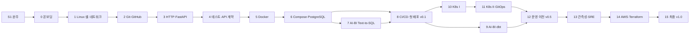

# ⛵ SAILINGSTONE QUEST S2 — SHIP IT
### 풀사이클 개발 학습 게임 설계서 v0.1 · 2026-11-08

> 이 문서의 용도: (1) 학습자가 전체 그림을 이해하는 지도, (2) AI 코딩 도구에 그대로 넘겨 게임을 제작하는 명세.
> 표기: ✅ 출처로 확인한 사실 · ⚠️ 출처 간 상충 또는 공식 문서 미확인 · 📐 설계 가정·추정치(실측으로 보정할 값)

---

## 0. 요약

- **무엇**: S1(SQL·Python)의 후속작. 가상 고객사 (주)한결정밀의 KPI API와 Text-to-SQL 서비스를 **직접 만들고(Build) → 배포하고(Ship) → 운영(Run)** 하는 터미널 게임. 진짜 도구를 진짜 환경에서 쓰고, 게임은 **시스템 상태를 검사해서 채점**한다.
- **목표 역량**: "AI-BI × DevOps". 데이터·AI 서비스를 만들고, 운영 가능한 수준으로 배포·관측·복구할 수 있는 사람.
- **규모** 📐: 16장(0~15장), 미션 204개, 약 295시간. 주 20시간이면 약 15주가 걸리고, S1 완주 1주(W0)가 별도로 필요하다.
- **최종 산출물**: 공개 리포 `hangyeol-kpi-api`
  - CI 배지, 테스트, 릴리스 v1.0.0
  - 라이브 URL: VPS의 k3s, HTTPS, GitOps
  - 운영 대시보드와 KPI 대시보드
  - Text-to-SQL 평가 리포트
  - Terraform DR 리허설 기록
  - 포스트모템
- **S1에서 바뀌는 점 3가지**
  1. 채점 방식: S1은 정답 결과와 비교했지만, S2는 **실제 시스템 상태를 검사**한다.
  2. **장애(incident) 미션**: 게임이 일부러 고장을 내고 복구 시간(MTTR)을 잰다.
  3. **AI 사용 정책 태그**(🔒/🤝/🚀)와 **설명 게이트**.
- **비용** 📐
  - VPS: 8장부터 월 1~2만 원.
  - AWS: 14장에서 신규 계정 크레딧 범위 안.
  - LLM API: 평가 1회(44문항)에 경량(Haiku 계열) 약 $0.01~0.05, 상위(Opus 계열) 약 $0.4~1.5 (7.4절).

---

## 1. 설계 근거

### 1.1 인터뷰 결과 → 설계 반영

| 항목 | 답 | 반영 |
|---|---|---|
| 목표 | AI-BI/데이터 + DevOps/클라우드 | 앱은 데이터 서비스 중심. 인프라는 DevOps 깊이(K8s·GitOps·IaC·관측성) |
| 프로젝트 | 세일링스톤 시즌2 | S1 자산(dbgen DB, KPI 정의서, 정답 SQL)을 재사용 |
| 시간 | 주 20시간 이상 | 장당 12~25시간. 마감이 없으니 깊이를 우선 |
| S1 진행 | 로컬에서 진행 중("40장" → 4장으로 해석, 확인 필요) | W0에 S1을 완주한 뒤 S2 시작 |
| 환경 | Mac Apple Silicon, 16GB 이상 | 로컬 k3d 멀티노드와 모니터링 스택 가능. Linux 실습은 VM에서 |
| 비용 | VPS 1대 + AWS 신규 크레딧 | VPS는 상시 운영 환경, AWS는 14장 단기 실습 후 삭제 |
| 마감 | 3개월 이상 또는 없음 | CKAD를 선택 트랙으로 둠 |
| 경험 | Git 브랜치·머지·충돌 해결 | 2장 배치고사로 Git 기초를 면제. 나머지는 기초부터 |

### 1.2 S1 리포(`sikomar00/sailingstone-quest`)에서 확인한 사실 → 반영

| 관찰 | 반영 |
|---|---|
| 원격 커밋 2개(모두 10/12), 최근 커밋 메시지 `,`, workspace 업로드 1회 | 2장에서 Conventional Commits를 검사. S2 채점의 상당수가 **GitHub 원격 상태** 기준이라 push가 게임 루프에 포함됨 |
| `save.json`이 gitignore 대상이라 진행 상황이 로컬에만 있음 | 상태는 SQLite로 저장하고, 산출물은 GitHub에 남는 구조 |
| 1-3 풀이: `WHERE ... short_qty > 0` (SELECT 별칭을 WHERE에서 사용) | SQLite는 허용하지만 **PostgreSQL은 오류** → 6-5(SQL 방언 이식)의 실전 함정으로 사용 |
| 1-5 풀이: `start_ts LIKE '2026-09%'` | Postgres의 timestamp 컬럼에는 LIKE를 쓸 수 없음 → 6-5 함정 |
| `engine.compare_rows`: 순서 무관 비교 + 실수 허용 오차 | Text-to-SQL 실행 정확도(EX) 채점기로 재사용(7-2) |
| SQL 티켓 44개(0~5장 42개 + B-1, B-2) | Text-to-SQL 평가셋 44문항 |
| `dbgen` 시드 고정(2026년 3분기) | 골든 테스트의 기준값. 4분기 이후 데이터는 날짜 시드 시뮬레이터로 추가하고 3분기 값은 고정 |
| 6-7 팁에 부트캠프 n8n 과정 언급 | 13장 알림 라우팅의 선택지로 n8n 사용 |

### 1.3 학습 설계 근거

- **인출 연습·분산 학습**: Dunlosky et al.(2013, *Psychological Science in the Public Interest* 14(1))은 10개 학습 기법 중 practice testing과 distributed practice만 "high utility"로 평가했다. → 매일 복습(간격 반복), 예측·드릴 미션.
- **시험 효과**: Roediger & Karpicke(2006, *Psychological Science* 17(3)) → 장마다 퀴즈와 승급 시험.
- **AI 보조와 숙련 형성** ✅: Anthropic 무작위 대조 실험(2026-01-29, 약 52명, Trio 라이브러리 학습).
  - 퀴즈 평균: AI 사용 그룹 50%, 직접 코딩 그룹 67%.
  - 작업 시간: 차이가 유의하지 않음(23분 vs 25분, p=0.391).
  - 격차가 가장 큰 영역: 디버깅.
  - 개념 질문 위주로 AI를 쓴 패턴은 65~86%, 코드 생성·디버깅을 맡긴 패턴은 24~39%.
  - 한계: 표본이 작고, 기간이 짧고, 라이브러리가 하나뿐.
  - → **디버깅(장애) 미션은 AI 금지, 개념 질문은 허용**.

---

## 2. 목표 역량과 졸업 기준 (전부 게임이 자동 검사)

| 영역 | 졸업 기준 |
|---|---|
| Linux | 원격 서버에서 로그 분석·권한·프로세스·서비스 관리. 점검 스크립트를 cron으로 운영 |
| Git/GitHub | 보호된 main, PR과 리뷰로만 머지, Conventional Commits, SemVer 릴리스 |
| API | FastAPI KPI API: OpenAPI 문서, 422/404 처리, 파라미터 바인딩 |
| 테스트 | pytest 커버리지 80% 이상, KPI 골든 테스트, Postman/Newman 스위트, Schemathesis 통과 |
| 컨테이너 | 이미지 200MB 이하, non-root, healthcheck, arm64+amd64, CRITICAL 취약점 0 |
| CI/CD | PR마다 lint·type·test·scan. main 머지 시 자동 배포. 액션은 SHA로 고정 |
| K8s | Helm 차트, probes·resources·PDB·NetworkPolicy·RBAC, Argo CD 동기화 |
| 운영 | HTTPS 라이브 URL, 백업·복구 드릴 성공, SLO 대시보드, 알림 실제 발송 |
| 클라우드 | Terraform으로 EKS 생성 → 배포 → 삭제. 과금 리소스 잔여 0을 검증 |
| AI-BI | dbt KPI 마트와 테스트, Text-to-SQL EX 리포트(모델·비용 비교), 개인정보 차단 |
| 장애 대응 | 장애 미션 MTTR 기록, 포스트모템 3건 |

---

## 3. 게임 디자인

### 3.1 세계관

S1 엔딩 이후의 이야기다. 한결정밀 PoC가 본계약으로 이어졌고, 계약 범위는 다음 세 가지다.
1. 경영진 KPI API와 대시보드
2. Text-to-SQL "KPI 비서"
3. 설비 진동 이상 알림

이 셋을 **한결정밀 공장 엣지 서버(k3s)** 에 설치하고 운영한다. AI-BI팀에는 운영 인력이 없어서 플랫폼팀이 멘토로 붙는다.

| 인물 | 역할 | 주로 등장하는 장 |
|---|---|---|
| 정다은 팀장 (AI-BI팀) | PM, 전환 심사 | 7, 15 |
| 윤서진 선임 (S1 사수) | 앱·데이터 멘토, 리뷰봇의 이름 | 2, 3, 6, 9 |
| **강태오 책임** (플랫폼팀, 신규) | Linux·Docker·K8s·CI 멘토 | 0, 1, 5, 8, 10~14 |
| **민하늘 주임** (QA, 신규) | 테스트 | 4 |
| **서지훈 과장** (한결정밀 전산팀, 신규) | 보안·계정·이미지 반입 요구 | 5, 6, 11, 12 |
| 오정민·박정훈·이미경·최동욱·한상철 (S1) | 고객사 요청자 | 전 장 |
| 🚨 **온콜봇** (신규) | 장애 알림 | 장애 미션 |

직급: 사원(0~4장) → 주임(5~8장) → 대리(9~12장) → 과장 후보(13~15장) → 엔딩.

### 3.2 핵심 루프

```
티켓 수신 → 개념 카드 → 실제 작업 → quest check
   → 체크리스트 피드백(✅/❌ + 함정 감지) → 통과 시 보상 + 설명 게이트
   → 카드가 복습 덱에 추가 → 다음 티켓
```

### 3.3 미션은 카드 3장으로 구성

S1의 `tip`을 세 장으로 확장한다. 요청하신 "기본개념 · 용법 · 도메인 지식"이 미션마다 하나씩 붙는 구조다.

| 카드 | 내용 | 예 (5-8 이미지 다이어트) |
|---|---|---|
| 🧩 개념 | 왜 그렇게 동작하는가 | 이미지는 레이어가 쌓인 것이다. 빌드 도구는 실행에 필요 없다 |
| 🔧 용법 | 명령·문법·설정 | `docker history`, `FROM ... AS builder`, `COPY --from=` |
| 🏭 도메인 | 실무 맥락, 업계 관행, 수치 | 폐쇄망 환경에서는 이미지 크기가 곧 반입 시간과 승인 절차 비용이다 |

복습 덱은 세 종류 카드를 모두 섞어서 출제한다.

### 3.4 미션 유형 7종

| 유형 | 표시 | 채점 | AI |
|---|---|---|---|
| 티켓(ops) | 🎫 | 상태 검사 체크리스트(파일, Git, HTTP, 컨테이너, 클러스터, 클라우드) | 🤝 기본 |
| 개념 퀴즈 | 🧠 | 객관식·단답·순서 맞추기 | 🔒 |
| 예측 | 🔮 | 실행 전에 결과를 예측해 입력 → 실제로 실행 → 비교·해설 | 🔒 |
| 드릴 | ⌨️ | 명령 회상(정규식으로 허용 답 매칭). 매일 복습에 출제 | 🔒 |
| 장애 | 🚨 | 게임이 장애를 주입 → 복구 상태 검사 + 근본 원인 퀴즈 + MTTR 측정 | 🔒 |
| 승급 시험·보스 | 🏁 | 장 산출물 체크 전체를 포함하는 상위집합 | 🔒/🤝 |
| 복습 | 📅 | 만기 도래 카드 + 예전 티켓을 빈 샌드박스에서 다시 만들기 | 🔒 |

설계 규칙: **보스의 체크는 그 장 모든 산출물 체크의 상위집합이다.** 따라서 승급 시험으로 남은 티켓을 면제받아도 다음 장에 필요한 산출물은 반드시 존재한다. S1의 면제 규칙을 운영 미션에 안전하게 이식하기 위한 조건이다.

### 3.5 AI 사용 정책

| 태그 | 의미 | 적용 |
|---|---|---|
| 🔒 solo | AI 사용 금지 | 퀴즈, 예측, 드릴, 장애, 시험 |
| 🤝 pair | 개념 질문과 코드 리뷰는 허용. 코드는 내가 먼저 작성 | 대부분의 티켓 |
| 🚀 delegate | AI가 생성해도 됨. 대신 설명 게이트를 통과해야 함 | 보일러플레이트(대시보드 JSON, OpenAPI 예시, 문서) |

- **설명 게이트**: 🤝·🚀 미션 통과 후 내 산출물에 대한 질문 2~3개에 답한다. 예: "Dockerfile에서 `uv.lock` 복사가 소스 복사보다 앞에 있는 이유는?" 질문은 미리 작성해 두고 결정적으로 채점한다.
- **강제 수단은 없다(자율 준수).** 대신 프로젝트 리포에 AI 튜터 모드를 설정해, AI가 현재 미션 태그를 읽고 그에 맞게 행동하게 만든다.

```markdown
# CLAUDE.md  (프로젝트 리포. 다른 도구는 AGENTS.md에 같은 내용을 둔다)
이 리포는 SAILINGSTONE QUEST S2 학습 프로젝트다. 목표는 내가 직접 이해하는 것이다.
- 작업 전에 `quest status --json`으로 현재 미션 ID와 AI 태그를 확인한다.
- 🔒 solo: 코드나 명령의 정답을 주지 않는다. 개념 설명과 되묻기 질문만 한다.
- 🤝 pair: 개념 질문과 리뷰는 자유롭게. 코드는 학습자가 먼저 쓰고, 너는 리뷰한다.
- 🚀 delegate: 코드를 생성해도 된다. 대신 바꾼 이유를 줄 단위로 설명한다.
```

- AI가 내장된 터미널(Warp 등)을 쓴다면 🔒 미션 동안에는 AI 기능을 끈다.

### 3.6 보상 규칙 (S1 계승 + 추가)

- **S1에서 그대로**: 원샷 +20%, 힌트 1개당 -20%(최대 -60%), 모범 답안 20% + 복습 목록 추가, 승급 시험으로 남은 티켓 면제(각 50%), 문법·실행 오류는 오답으로 세지 않음.
- **추가**
  - 장애 미션: 목표 MTTR 안에 복구하면 +30%. 장애 중에는 힌트 비용이 2배.
  - 예측 미션: 예측이 맞으면 +10%.
  - 설명 게이트를 통과해야 XP가 확정된다.
- **배지**: 🟢 첫 그린 CI · 🔁 reflog 구조대 · 🐳 200MB 다이어트 · 🧱 멀티아키 · 🧪 골든 키퍼(방언 이식을 테스트로 지켜냄) · ☸️ 셀프 힐러 · 🚒 인시던트 커맨더(목표 MTTR 5회 달성) · 🔐 전산팀 통과 · 💸 제로 잔여(AWS 정리 검증) · 📈 DORA 리포터 · 📅 꾸준함(복습 14일 연속) · 🏁 전환 심사 2.

### 3.7 복습 시스템

- 카드(퀴즈·드릴·개념)는 처음에 Leitner 5단계 상자로 시작하고, 데이터가 쌓이면 FSRS(`fsrs` 패키지)로 교체를 검토한다.
- `quest review`: 만기 카드 10~15장, 약 15분 📐.
- 주 1회 **재구성 복습**: 예전 티켓을 빈 샌드박스에서 다시 만든다(예: 빈 폴더에서 Dockerfile 작성).
- 10장 이후에는 **온콜 주간**(선택)을 쓸 수 있다. `quest oncall start`를 켜 두면 일주일 동안 무작위 시각에 이미 클리어한 장애가 재발한다. 디버깅을 인출 연습시키는 장치다.

### 3.8 계측과 일정 보정 (데이터 기반 운영)

- 미션마다 시작 시각, 첫 check, 완료 시각, 실패 횟수, 힌트 수, AI 태그를 SQLite에 기록한다.
- `quest stats`로 장별 실측 시간과 예상 시간(`est_min`), 유형별 힌트 사용률, 복습 정답률을 본다. 데이터는 SQL로 직접 조회할 수 있다. 내 학습 데이터를 SQL로 분석하는 것 자체가 S1 역량의 재사용이다.
- **1장과 2장이 끝나면 전체 일정을 실측치로 다시 계산한다.** 이 문서의 시간은 전부 📐 추정치다.

### 3.9 플레이 화면 예시

```
$ quest
  ⛵ SAILINGSTONE QUEST S2 · SHIP IT     주임 · 3,420 XP · 📅 복습 9일 연속
  📈 5장 Docker ▓▓▓▓▓▓▓░░░░░ 7/13      오늘 복습 카드 12장 (quest review)
  ▶ 현재 티켓 5-8 이미지 다이어트: 1.2GB → 200MB 이하   🤝 pair · 예상 60분

$ quest check
  채점 중… [5-8]
   ✅ kpi-api:dev 이미지가 있다
   ❌ 이미지 크기 ≤ 200MB          (현재 1,184MB)
   ✅ 컨테이너에서 /health 200
   ❌ 이미지 안에 .env가 없다       ← .dockerignore를 확인하세요
  💡 자주 하는 실수: 풀 이미지(python:3.x)를 쓰고 있어요. -slim 태그와 크기를 비교해 보세요.
```

---

## 4. 커리큘럼

### 4.1 로드맵



| 장 | 주차 📐 | 주제·도구 | 프로젝트 산출물 | 대표 장애 | 시간 📐 |
|---|---|---|---|---|---|
| W0 | 11/9~ | S1 4~7장 완주 | S1 PoC (Text-to-SQL 평가셋의 원천) | — | 15h |
| 0 | W1 | Homebrew, zsh, SSH, OrbStack/Colima | dotfiles 리포, `quest doctor` 전부 통과 | — | 6h |
| 1 | W1~2 | Linux, bash, 네트워크, SSH, cron, systemd | 무인 점검 스크립트(cron) | 디스크 100%, 포트 충돌 | 25h |
| 2 | W2~3 | Git 심화, GitHub(PR, ruleset, gh) | 공개 리포, 보호 규칙, v0.0.1 | reflog 복구, .env 푸시 | 12h |
| 3 | W3~4 | HTTP, FastAPI, Pydantic, uv | KPI API v0 (S1 SQL 이식) | — | 20h |
| 4 | W4 | pytest, Postman/Newman, Schemathesis | 골든 테스트, 계약 테스트, v0.2 | git bisect | 15h |
| 5 | W4~5 | Docker, buildx, hadolint, Trivy | 200MB 이하·non-root·멀티아키 이미지 | 바로 죽는 컨테이너 | 20h |
| 6 | W5~6 | Compose, PostgreSQL, Alembic, sqlglot | 원커맨드 스택 + Grafana KPI 대시보드 | 커넥션 폭주, 볼륨 삭제 | 20h |
| 7 | W6~7 | **[AI-BI]** LLM API, 평가, SQL 가드 | `/v1/ask` + EX·비용 리포트 | 프롬프트 인젝션 | 15h |
| 8 | W7~8 | GitHub Actions, GHCR, VPS, Caddy | **🎯 v0.1 라이브 URL** | 빨간 main, exec format error, 롤백 | 22h |
| 9 | W8~9 | **[AI-BI]** dbt, 데이터 품질 | KPI 마트, 테스트, docs 사이트 | — | 12h |
| 10 | W9~10 | Kubernetes(k3d), kubectl, k9s | 전체 스택 매니페스트 | CrashLoop, ImagePull, OOM, Pending | 25h |
| 11 | W10~11 | Helm, Ingress(Traefik), RBAC, NetworkPolicy, Argo CD | Helm 차트 + GitOps | drift, 잘못된 values | 25h |
| 12 | W11~12 | VPS k3s, Tailscale, Let's Encrypt, 백업 | **🎯 v0.5 운영 이전** | 노드 디스크 압박 | 18h |
| 13 | W12~13 | Prometheus, Grafana, Loki, Alertmanager, SLO | SLO 대시보드 + 알림 | 지연 급증, 카디널리티 폭발 | 22h |
| 14 | W13~14 | AWS(IAM, VPC, ECR, EKS), Terraform, OIDC | DR 리허설 + 잔여 0 | 콘솔 수정 drift | 22h |
| 15 | W14~15 | 문서화, Game Day, DORA | **🎯 v1.0.0 + 포트폴리오** | 무작위 3건 | 15h |

합계 294시간(W0 제외) 📐. 주 20시간 기준으로 누적 시간을 주차에 나눈 값이며, 연말연시와 설 연휴는 반영하지 않았다. 1·2장 실측 후 재계산한다.

미션 표기: 🎫 티켓 · 🧠 퀴즈 · 🔮 예측 · ⌨️ 드릴 · 🚨 장애 · 🏁 시험·보스. 🎫는 기본이 🤝이고, 🚀인 미션만 따로 표시한다.

---

### 0장. 온보딩: 장비 지급 — 강태오 · 📐6h · 🎯 dotfiles 리포, `quest doctor` 전부 통과

- **개념**: 패키지 매니저, PATH와 셸 설정 파일(`~/.zshrc`), 재현 가능한 환경(Brewfile·dotfiles), 공개키 인증, 맥의 컨테이너가 Linux VM 위에서 도는 이유(macOS 커널은 Linux가 아님), CPU 아키텍처(arm64/amd64)
- **용법**: `brew bundle`, `which`, `echo $PATH`, `ssh-keygen -t ed25519`, `ssh -T git@github.com`, `gh auth login`, `git config --global`, `uname -m`
- **도메인**: 개발환경도 코드다. 장비 교체나 팀원 합류 시 온보딩 시간이 줄어든다. 맥(arm64)에서 만든 이미지가 x86 서버에서 안 도는 문제(8-I2)가 여기서 출발한다.
- **미션**
  - 0-1 🎫 장비 점검(`quest doctor`)
  - 0-2 🎫 Brewfile로 일괄 설치
  - 0-3 🎫 PATH와 alias
  - 0-4 🎫 dotfiles 리포 push
  - 0-5 🎫 SSH 키로 GitHub 인증
  - 0-6 🔮 맥의 `uname -m` vs 컨테이너 안의 `uname -m`
  - 0-7 🧠 장 퀴즈

### 1장. Linux·셸·네트워크: 공장 서버 hg-edge-01 — 강태오·한상철 · 📐25h · 🎯 무인 점검 스크립트와 서비스 유닛

- **랩**: Ubuntu 24.04 VM. 기본은 OrbStack Linux machine(예: `orb create ubuntu hg-edge-01`), 대안은 Lima나 Multipass. 게임은 SSH 별칭으로 접속해서 검사하고, cloud-init으로 공장 로그·사용자·문제 상황을 미리 심어 둔다. 맥 터미널의 BSD 도구와 GNU 도구는 옵션이 달라서(예: `sed -i`) Linux 실습은 VM에서만 한다.
- **개념**
  - 파일시스템: FHS(`/etc` `/var` `/opt` `/home` `/proc`), 모든 것은 파일
  - 권한과 계정: rwx, 8진수 표기, 소유자/그룹, 사용자·그룹·sudo
  - 프로세스: PID, 시그널(SIGTERM vs SIGKILL), 포그라운드/백그라운드
  - 입출력과 셸: stdin/stdout/stderr, 파이프, 리다이렉션, 종료 코드, 환경변수, 셸 스크립트
  - 서비스 운영: cron, systemd·journald, apt
  - 네트워크: IP, 포트, DNS, TCP, localhost와 0.0.0.0의 차이
  - SSH: 키, config, 포트 포워딩
- **용법**
  - 탐색·텍스트 처리: `ls -la` `find` `grep -E` `awk` `sed` `sort | uniq -c | sort -nr` `tail -f` `xargs` `jq`
  - 권한·프로세스·자원: `chmod` `chown` `ps aux` `kill` `ss -tulpn` `lsof -i` `df -h` `du -sh` `free -h`
  - 서비스·네트워크: `systemctl` `journalctl -u -f` `crontab -e` `curl -v` `dig` `ssh -L` `rsync`
- **도메인**: 엣지 서버 운영(야간 교대 중 장애 대응 절차), 로그 보존과 로테이션, 서버 시간대(UTC vs KST)와 교대 경계, 최소권한 계정, "서버는 애완동물이 아니라 가축"
- **미션**
  - 1-1 🎫 첫 접속(호스트·OS·커널 확인)
  - 1-2 🧠 FHS 지도
  - 1-3 🎫 어제 ERROR 건수
  - 1-4 🔮 설비별 경보 TOP 3 파이프라인
  - 1-5 🎫 실행되지 않는 스크립트(권한)
  - 1-6 🎫 운영자 계정과 최소 sudo
  - 1-7 🎫 폭주 프로세스 정상 종료
  - 1-8 🎫 일일 로그 요약 스크립트(`set -euo pipefail`, 종료 코드)
  - 1-9 🎫 cron 등록(PATH·TZ 함정)
  - 1-10 🎫 systemd 서비스와 journalctl
  - 1-11 🔮 0.0.0.0과 127.0.0.1
  - 1-12 🎫 curl -v와 dig로 요청 해부
  - 1-13 🎫 SSH config와 포트 포워딩
  - 1-I1 🚨 디스크 100%(야간조 로그 폭주)
  - 1-I2 🚨 포트 충돌로 서비스 기동 실패
  - 1-B 🏁 무인 점검 스크립트: 디스크·메모리·서비스 → JSON 리포트 → cron
- **함정**: cron 환경의 PATH, `>`와 `>>`, `kill -9` 남용, `chmod 777`
- **사이드 퀘스트**: OverTheWire Bandit 0→15, SadServers 입문 시나리오, explainshell.com

### 2장. Git 심화·GitHub 협업 — 윤서진 + 리뷰봇 · 📐12h · 🎯 `hangyeol-kpi-api` 공개 리포(보호 규칙·템플릿·v0.0.1)

- **배치고사 2-0**을 통과하면 2-1·2-3·2-6이 면제된다(브랜치·머지·충돌 경험 반영).
- **개념**: 스냅샷과 커밋 그래프, HEAD와 refs, 스테이징, merge vs rebase, 원격 추적 브랜치, reflog, 태그와 SemVer, PR·리뷰·rulesets·CODEOWNERS, GitHub Flow
- **용법**: `git log --graph --oneline --all`, `git add -p`, `git rebase -i`, `git commit --amend`, `git cherry-pick`, `git reflog`, `git revert`, `git tag -a`, `gh repo create`, `gh pr create/checks/merge`, `gh issue create`
- **도메인**: Conventional Commits와 변경 이력 자동화, PR 크기와 리뷰 품질의 관계, 시크릿 유출 시 1순위는 키 폐기(히스토리 삭제는 그다음), SemVer
- **리뷰봇**: 게임이 프로젝트 리포에 설치하는 Actions 워크플로다. PR 제목 규약, 연결된 이슈, 변경 크기, 테스트 동반 여부를 검사하고 "윤서진 선임" 이름으로 코멘트를 단다.
- **미션**
  - 2-0 🏁 배치고사
  - 2-1 🔮 HEAD는 어디를 가리키나
  - 2-2 🎫 프로젝트 리포 생성(README·.gitignore·LICENSE·가상 설정 고지)
  - 2-3 🎫 Conventional Commits와 커밋 쪼개기
  - 2-4 🎫 Issue → 브랜치 → PR → 리뷰봇 지적 반영 → 머지
  - 2-5 🎫 main 보호(ruleset)
  - 2-6 🎫 rebase -i로 커밋 정리
  - 2-7 🎫 태그·릴리스 v0.0.1
  - 2-8 🎫 pre-commit + gitleaks
  - 2-I1 🚨 reset 사고 → reflog 복구
  - 2-I2 🚨 .env 푸시 사고(키 폐기 → `git filter-repo` → 재발 방지)
  - 2-B 🏁 충돌하는 PR 2개 정리 후 순차 머지
- **사이드 퀘스트**: Learn Git Branching(main·remote 코스)

### 3장. HTTP·FastAPI: KPI API v0 — 윤서진·오정민·박정훈 · 📐20h · 🎯 KPI API v0 (SQLite 읽기 전용)

- **개념**
  - HTTP: 요청/응답 구조, 메서드의 안전성과 멱등성, 상태 코드, 헤더, JSON
  - API 설계: REST 자원 설계, path vs query, 페이지네이션, 버전(`/v1`), OpenAPI
  - FastAPI: ASGI와 uvicorn, Pydantic v2, 검증과 422, response_model, 의존성 주입, 라우터
  - 그 밖: 설정(pydantic-settings), async와 이벤트 루프 블로킹, CORS
- **용법**: `uv init`, `uv add fastapi uvicorn`, `uv run uvicorn app.main:app --reload`, `curl -i`, `xh`, `/docs`, `/openapi.json`
- **도메인**: KPI 정의서는 API 계약이다(지표 정의가 바뀌면 버전이 바뀐다). 응답에 단위와 기준을 명시한다(%, 소수 둘째 자리, 월 경계는 KST). 고객사 요청을 엔드포인트로 번역하는 연습.
- **엔드포인트**
  - `GET /health`
  - `GET /v1/lines`
  - `GET /v1/kpi/availability?month=` (S1 B-1)
  - `GET /v1/kpi/summary?month=` (S1 B-2)
  - `GET /v1/kpi/otd?month=` (S1 납기준수율)
  - `GET /v1/equipment/{id}/vibration-alerts?ratio=` (S1 6-7)
- **미션**
  - 3-1 🔮 curl -v 출력 읽기
  - 3-2 🧠 상황별 상태 코드
  - 3-3 🎫 uv 프로젝트와 /health
  - 3-4 🎫 path·query 파라미터(404 포함)
  - 3-5 🎫 Pydantic 모델과 422
  - 3-6 🎫 가동률 API(B-1 이식)
  - 3-7 🎫 종합 KPI와 납기준수율
  - 3-8 🎫 의존성 주입(DB·설정)
  - 3-9 🎫 SQL 인젝션 방어(f-string 함정 → 파라미터 바인딩, S1 6-6 팁 연결)
  - 3-10 🎫 설정은 환경변수로
  - 3-11 🔮 async 안의 블로킹 호출
  - 3-12 🎫🚀 OpenAPI 설명·예시 보강
  - 3-B 🏁 진동 이상 알림 API(에러 처리·문서 포함)

### 4장. 테스트·API 계약 — 민하늘 · 📐15h · 🎯 v0.2.0 (pytest·골든·Postman/Newman·Schemathesis)

- **개념**
  - 테스트 일반: 테스트 피라미드, 단위/통합/E2E, 픽스처, parametrize, 골든 테스트, 커버리지의 의미와 한계, 계약 테스트, 속성 기반 테스트(퍼징), 회귀
  - Postman: 컬렉션·폴더·환경, 변수 스코프, 스크립트(`pm.test`, `pm.expect`), 체이닝, 러너, 내보내기(v2.1)
- **용법**: `pytest -q -k -x --cov`, FastAPI `TestClient`, `newman run collection.json -e env.json -r cli,json`, `schemathesis run`
- **도메인**: KPI 회귀는 경영회의 숫자 사고로 이어진다. 테스트는 실행 가능한 KPI 정의서다. 버그는 재현하는 실패 테스트부터 쓴다.
- **사실**
  - ✅ Postman Free는 2026-03-01부터 1인 전용이고 팀을 만들 수 없다. 혼자 학습하기에는 충분하다.
  - ⚠️ 내보낸 컬렉션 파일을 Newman으로 실행할 때 앱 러너의 월 한도가 적용되지 않는다는 답변은 Postman 커뮤니티 스태프의 비공식 답변뿐이다.
  - 대안: Bruno(컬렉션을 Git 파일로 관리).
- **미션**
  - 4-1 🧠 테스트 피라미드
  - 4-2 🎫 첫 pytest
  - 4-3 🎫 골든 테스트(S1 정답 결과 = 기준값)
  - 4-4 🎫 경계값 parametrize
  - 4-5 🎫 커버리지 80%
  - 4-6 🎫 Postman 컬렉션과 환경변수
  - 4-7 🎫 테스트 스크립트와 체이닝
  - 4-8 🎫 Newman CLI와 JSON 리포트
  - 4-9 🎫 Schemathesis로 500 찾기
  - 4-I1 🚨 언제부터 숫자가 틀렸나(`git bisect run pytest`)
  - 4-B 🏁 계약 테스트 스위트 + v0.2.0

### 5장. Docker — 강태오·서지훈 · 📐20h · 🎯 프로덕션급 이미지(GHCR)

- **개념**
  - 기본 모델: 이미지·컨테이너·레이어·레지스트리·태그·다이제스트, 컨테이너 = 격리된 프로세스(namespaces·cgroups), 휘발성 파일시스템
  - 실행: 포트 공개, 볼륨 vs 바인드 마운트, 네트워크
  - 빌드: Dockerfile 명령, 빌드 컨텍스트와 .dockerignore, 레이어 캐시 순서, 멀티스테이지, 베이스 이미지 선택
  - 운영 품질: non-root, HEALTHCHECK, PID 1과 시그널(exec form), buildx 멀티아키, 취약점 스캔과 SBOM
- **용법**: `docker run -d -p -e -v --name`, `ps -a`, `logs -f`, `exec -it`, `inspect`, `stats`, `system df`, `build -t`, `buildx build --platform linux/amd64,linux/arm64 --push`, `buildx imagetools inspect`, `hadolint`, `dive`, `trivy image`
- **도메인**
  - "내 PC에선 되는데" 문제의 해법.
  - build once, deploy many.
  - 태그 전략: git SHA + SemVer. 운영 배포에 latest를 쓰지 않는다.
  - 공급망 위험 ✅: 2025-08-28 Bitnami가 무료 카탈로그를 축소했다. 버전 태그 이미지는 `bitnamilegacy`로 옮겨져 업데이트가 중단됐다. 의존하던 이미지가 하루아침에 바뀔 수 있다는 사례다.
  - 폐쇄망 반입(`docker save/load`): 이미지 크기가 곧 반입 비용이다.
- **미션**
  - 5-1 🔮 명령이 끝나면 컨테이너는 어떻게 되나
  - 5-2 🎫 nginx와 포트 매핑
  - 5-3 🎫 exec·logs·inspect
  - 5-4 🔮 컨테이너를 지우면 데이터는
  - 5-5 🎫 첫 Dockerfile(KPI API)
  - 5-6 🎫 레이어 캐시 순서
  - 5-7 🎫 .dockerignore(이미지에 .env 없음)
  - 5-8 🎫 이미지 다이어트 200MB 이하
  - 5-9 🎫 non-root와 HEALTHCHECK
  - 5-10 🎫 hadolint 0건, Trivy CRITICAL 0건
  - 5-11 🎫 멀티아키 빌드 → GHCR
  - 5-I1 🚨 바로 죽는 컨테이너(127.0.0.1 바인딩)
  - 5-B 🏁 프로덕션급 이미지 기준 충족

### 6장. Compose·PostgreSQL (데이터 계층) — 강태오·윤서진·서지훈 · 📐20h · 🎯 `docker compose up` 원커맨드 스택 + Grafana KPI 대시보드 v1

- **개념**
  - Compose: 멀티 컨테이너 앱, 서비스 DNS, depends_on과 healthcheck 조건, named volume, env_file, profiles, compose watch
  - PostgreSQL: role·권한·스키마, 연결 문자열, 커넥션 풀, 인덱스와 EXPLAIN, 트랜잭션
  - 마이그레이션과 이식: SQLAlchemy 2.0, Alembic, SQL 방언 차이, COPY 적재, `pg_dump`/`pg_restore`
- **용법**: `docker compose up -d/ps/logs/exec/down`, `docker compose config`, `psql \dt \d+`, `EXPLAIN ANALYZE`, `alembic revision --autogenerate`, `alembic upgrade head`, `sqlglot.transpile(sql, read="sqlite", write="postgres")`
- **도메인**: dev/prod 동등성(12-factor X), 상태 저장 서비스 vs 무상태 서비스, 백업 3-2-1, expand-contract 마이그레이션, DB 최소권한(Text-to-SQL용 읽기 전용 role), 개인정보 컬럼(`workers.worker_name`) 접근 통제
- **S1 풀이에서 나온 함정**: 1-3의 WHERE 별칭과 1-5의 timestamp LIKE는 Postgres로 옮기면 오류가 난다. 골든 테스트가 이를 잡아내는 경험이 이 장의 핵심이다.
- **미션**
  - 6-1 🎫 api + postgres compose
  - 6-2 🔮 컨테이너 안의 localhost
  - 6-3 🎫 healthcheck와 기동 순서
  - 6-4 🎫 S1 데이터 적재(COPY)
  - 6-5 🎫 SQL 방언 이식(골든 테스트로 검증)
  - 6-6 🎫 Alembic
  - 6-7 🎫 인덱스와 EXPLAIN으로 느린 쿼리 개선
  - 6-8 🎫 읽기 전용 role과 컬럼 권한(개인정보)
  - 6-9 🎫 .env 분리와 .env.example
  - 6-10 🎫 백업·복구 드릴
  - 6-11 🎫 compose watch 개발 루프
  - 6-I1 🚨 too many connections
  - 6-I2 🚨 `down -v`로 데이터 증발 → 백업으로 복원
  - 6-B 🏁 원커맨드 스택 + Grafana KPI 대시보드(as code)

### 7장. [AI-BI] Text-to-SQL v0 + 평가 하네스 — 정다은·오정민 · 📐15h · 🎯 `/v1/ask` + 평가 리포트(EX·비용·지연)

- **개념**
  - LLM API 기초: 메시지, 토큰, 비용, 지연
  - 프롬프트 구성: 역할, 스키마, KPI 정의서, 규칙, few-shot. 구조화 출력(JSON)
  - 평가: 실행 정확도(EX) vs 문자열 일치, 데이터 누수(few-shot 풀과 테스트셋 분리), 베이스라인, 오류 분석
  - 가드레일: SQL 파싱(단일 SELECT, 허용 테이블, LIMIT), 읽기 전용 role, statement_timeout, 프롬프트 인젝션
  - 비용: 프롬프트 캐싱, Batch API, 토큰 카운트. 공개 엔드포인트는 비용 공격의 표면이 된다(인증·레이트리밋 필요)
- **용법**: Anthropic Python SDK(`anthropic`), `client.messages.count_tokens`, `response.usage.cache_read_input_tokens`, `sqlglot.parse_one`, `SET statement_timeout`
- **구현 메모(제작 시)**
  - 기본 모델은 구현 시점의 최신 Opus 계열로 한다. 정확한 모델 ID는 공식 모델 목록(Models API)에서 확인한다. 2026-10 기준 최신 Opus는 thinking을 끌 수 없고 effort 기본값이 `medium`이므로 effort를 명시한다.
  - `stop_reason == "refusal"`을 처리한다.
  - 구조화 출력은 `output_config.format`으로 받는다.
  - 고정 접두부(스키마 + 정의서 + few-shot)에 `cache_control`을 건다. 이 모델들의 최소 캐시 길이는 512토큰이다.
  - 야간 평가는 Batch API로 돌린다(비용 50%).
  - **모델을 바꿀지는 학습자가 7-8의 측정 결과로 결정한다.**
- **도메인**: 셀프서비스 분석, 지표 정의(시맨틱 레이어)가 환각을 줄인다, 경영 보고에는 사람 검토 단계를 둔다, 설명 가능성(SQL과 근거를 함께 표시), 데이터 거버넌스(개인정보·권한)
- **미션**
  - 7-1 🎫 S1 SQL 티켓 44개 → 평가셋(JSONL)
  - 7-2 🎫 실행 정확도 채점기(S1 `compare_rows` 재사용, 정답끼리 비교하면 100%)
  - 7-3 🧠 데이터 누수와 dev/test 분할
  - 7-4 🎫 첫 LLM 호출과 토큰·비용 로깅
  - 7-5 🎫 프롬프트 v1 → EX 측정
  - 7-6 🎫 SQL 가드(인젝션 케이스 전부 차단)
  - 7-7 🎫 프롬프트 캐싱 효과 실측
  - 7-8 🎫 모델·effort 비교표(정확도·비용·지연) → 선택 근거 기록
  - 7-9 🎫 `/v1/ask`(인증·레이트리밋 포함)
  - 7-I1 🚨 프롬프트 인젝션으로 작업자 개인정보 요청
  - 7-B 🏁 오류 분석 리포트 → 개선 → EX 향상

### 8장. CI/CD + 첫 배포 — 강태오 · 📐22h · 🎯 v0.1 공개(라이브 URL, CI 배지)

- **개념**
  - 개념 구분: CI vs 지속적 전달 vs 지속적 배포
  - GitHub Actions 구조: workflow·event·job·step·runner·action, 트리거, 컨텍스트와 표현식
  - 워크플로 구성: secrets/vars, matrix, 캐시, artifacts, 서비스 컨테이너, concurrency, environments와 보호 규칙
  - 보안: `permissions:` 최소권한, 액션 SHA 고정, Dependabot
  - 배포: 배포 전략(recreate·rolling·blue-green)과 롤백, 리버스 프록시와 TLS(Caddy 자동 HTTPS), DNS A 레코드, 방화벽
- **용법**: `.github/workflows/*.yml`, `gh run list/view --log-failed/watch`, `gh workflow run`, `act`, `actionlint`, `zizmor`
- **도메인**
  - DORA 지표: 배포 빈도, 변경 리드타임, 변경 실패율, 복구 시간.
  - 빨간 main이 최우선이다. shift-left.
  - 공급망 사고 사례: 2025년 3월 tj-actions/changed-files 침해(CVE-2025-30066)로 이 액션을 쓰던 리포들의 CI 로그에 시크릿이 노출됐다. 액션을 SHA로 고정하는 이유다.
- **사실**
  - ✅ 공개 리포는 표준 GitHub 호스티드 러너가 무료다(무료 할당 유지).
  - ✅ 2026-01-01부터 호스티드 러너 단가가 최대 39% 인하됐다.
  - ⚠️ self-hosted 러너 플랫폼 요금은 발표 후 연기됐다. 현재 상태는 공식 문서로 확인해야 한다.
- **미션**
  - 8-1 🧠 워크플로 해부
  - 8-2 🎫 첫 CI(ruff + pytest)
  - 8-3 🎫 Postgres 서비스 컨테이너로 통합 테스트
  - 8-4 🎫 캐시로 CI 시간 단축(이전 실행 대비 측정)
  - 8-5 🎫 Newman과 Schemathesis를 CI에
  - 8-6 🎫 required checks 연결
  - 8-7 🎫 이미지 빌드·스캔 → GHCR(sha 태그)
  - 8-8 🎫 permissions 최소화, SHA 고정, zizmor
  - 8-9 🎫 Dependabot PR 처리
  - 8-10 🎫 VPS 준비(계정, SSH 키 전용 로그인, 방화벽, 자동 보안 업데이트)
  - 8-11 🎫 Compose + Caddy로 HTTPS 배포
  - 8-12 🎫 main 머지 → 자동 배포(environment 승인, `/version`으로 배포된 SHA 확인)
  - 8-13 🎫 LLM 평가 CI 게이트(라벨·경로 필터·야간 실행·비용 상한)
  - 8-I1 🚨 빨간 main
  - 8-I2 🚨 exec format error(arm64 이미지를 amd64 서버에)
  - 8-I3 🚨 배포 후 500 → 롤백
  - 8-B 🏁 v0.1 공개(릴리스 노트, 배지, 라이브 URL)
- **VPS 아키텍처**: amd64를 권장한다. 8-I2를 실제로 겪고 멀티아키 빌드의 필요성을 체감하기 위해서다. ARM VPS를 고르면 8-I2는 시뮬레이션으로 대체한다.

### 9장. [AI-BI] dbt·데이터 품질 — 이미경·오정민·윤서진 · 📐12h · 🎯 dbt KPI 마트 + 테스트 + 문서 사이트

- **개념**: ELT, 분석 엔지니어링, dbt 구조(sources·models·seeds·tests·docs·macros), materialization, `ref()`와 DAG·리니지, generic/singular 테스트, freshness, 지표를 코드로 관리
- **용법**: `dbt debug/run/test/build/docs generate`, `--select +model`, `state:modified`
- **도메인**: KPI 정의서의 코드화, S1 6장 정합성 검증을 상시 테스트로 전환, 데이터 품질 SLA, 리니지 기반 영향도 분석
- **미션**
  - 9-1 🧠 ELT와 분석 엔지니어링
  - 9-2 🎫 dbt 프로젝트와 소스
  - 9-3 🎫 staging 모델 + 이상 레코드 제외(S1 6-5 규칙)
  - 9-4 🎫 KPI 마트(B-2 결과와 일치)
  - 9-5 🎫 테스트(S1 6-3·6-4를 singular test로, 알려진 데이터 이슈는 warn)
  - 9-6 🎫 dbt docs → GitHub Pages
  - 9-7 🎫 CI에서 변경된 모델만 빌드
  - 9-8 🎫 API를 마트 기반으로 전환(골든 테스트 유지)
  - 9-B 🏁 가동률 정의 v2 변경 요청: 리니지 확인 → 모델·API·테스트·문서를 한 PR로
- **사이드 퀘스트**: Metabase를 마트에 연결(BI 도구 경험)

### 10장. Kubernetes I (로컬 k3d) — 강태오 · 📐25h · 🎯 KPI 스택 매니페스트(로컬에서 재현 가능)

- **개념**
  - 왜 필요한가: 오케스트레이션이 푸는 문제
  - 구조: 컨트롤 플레인(apiserver·etcd·scheduler·controller-manager), 노드(kubelet·kube-proxy·런타임)
  - 동작 원리: 선언형 desired state와 조정 루프, 오브젝트 구조(apiVersion·kind·metadata·spec·status), 라벨·셀렉터, 네임스페이스
  - 워크로드: Pod, ReplicaSet, Deployment(롤링 업데이트·롤백), Job·CronJob(`timeZone`), StatefulSet·PVC
  - 네트워크와 설정: Service(ClusterIP·NodePort·LoadBalancer)와 클러스터 DNS, ConfigMap·Secret(base64는 암호화가 아님)
  - 안정성: probes, requests/limits와 QoS, OOMKilled
- **용법**: `k3d cluster create --agents 2`, `kubectl get/describe/logs --previous/exec/apply/explain/rollout/scale/port-forward/top`, `-o yaml`, `-o jsonpath`, `k9s`, `stern`, `kubectx`/`kubens`
- **도메인**: 조정 루프의 사고방식, 파드는 가축, 교대 마감 집계 CronJob의 시간대(기본 UTC vs KST). 엣지에는 k3s처럼 가벼운 단일 바이너리 배포판이 쓰인다. 로컬 k3d와 운영 k3s가 같은 배포판이라 환경 동등성이 생긴다.
- **미션**
  - 10-1 🧠 아키텍처
  - 10-2 🎫 3노드 k3d 클러스터
  - 10-3 ⌨️ kubectl 생존 키트
  - 10-4 🔮 파드를 지우면?
  - 10-5 🎫 Service와 DNS
  - 10-6 🎫 ConfigMap·Secret 주입
  - 10-7 🎫 Postgres StatefulSet과 PVC
  - 10-8 🎫 probes
  - 10-9 🎫 requests/limits
  - 10-10 🎫 롤링 업데이트와 롤백
  - 10-11 🎫 4분기 데이터 시뮬레이터 CronJob(Asia/Seoul)
  - 10-12 🎫 dbt build Job
  - 10-I1 🚨 CrashLoopBackOff
  - 10-I2 🚨 ImagePullBackOff
  - 10-I3 🚨 OOMKilled
  - 10-I4 🚨 Pending
  - 10-I5 🚨 엔드포인트 없는 Service
  - 10-B 🏁 `kubectl apply -k` 한 번으로 전체 스택 재현
- **사이드 퀘스트**: Killercoda 쿠버네티스 시나리오(무료)

### 11장. Kubernetes II + GitOps — 강태오·서지훈 · 📐25h · 🎯 Helm 차트 + Argo CD + 보안 체크리스트 통과

- **개념**
  - 외부 노출: Ingress와 컨트롤러(k3s 기본은 Traefik), Gateway API, cert-manager와 Issuer
  - 패키징: Helm(차트·템플릿·values·릴리스), Kustomize와 비교
  - 확장과 가용성: HPA(metrics-server), 부하 테스트, PDB
  - 보안: NetworkPolicy(기본 차단), RBAC(ServiceAccount·Role·RoleBinding), Pod Security Standards(restricted), securityContext, Git 안의 Secret(Sealed Secrets 또는 SOPS+age)
  - GitOps: 4원칙(선언형, 버전 관리·불변, 자동 pull, 지속 조정), Argo CD(Application·sync·health·self-heal·prune)
- **용법**: `helm create/lint/template/install/upgrade/rollback`, `kubectl auth can-i --as`, `argocd app get/sync/diff`, `k6 run`, `kubeseal` 또는 `sops -e`
- **도메인**
  - ✅ ingress-nginx는 2026년 3월에 은퇴했다. 이후 릴리스·버그 수정·보안 패치가 없다. 그래서 이 과정은 Traefik과 Gateway API로 배운다.
  - 고객사 전산팀 보안 요구사항: 외부 노출 최소화, 계정 최소권한, 감사 가능성.
  - "운영 환경에서 kubectl edit 금지" 문화와 drift.
  - Sealed Secrets는 Bitnami 계열 프로젝트다. 설치할 때 이미지 출처를 확인한다.
- **미션**
  - 11-1 🎫 Ingress 호스트 라우팅
  - 11-2 🎫 cert-manager TLS(로컬 CA)
  - 11-3 🎫 Helm 차트(values-dev/prod)
  - 11-4 🎫 HPA와 k6로 스케일 아웃 관찰(p95 기록)
  - 11-5 🎫 PDB
  - 11-6 🎫 NetworkPolicy(api → db만 허용)
  - 11-7 🎫 전산팀 읽기 전용 RBAC
  - 11-8 🎫 securityContext와 restricted
  - 11-9 🎫 Git에 평문 Secret 0건
  - 11-10 🎫 Argo CD Application
  - 11-11 🎫 CI → 이미지 태그 갱신 → 자동 동기화
  - 11-I1 🚨 누군가 kubectl edit → drift → self-heal
  - 11-I2 🚨 잘못된 values → git revert로 롤백
  - 11-B 🏁 전산팀 보안 심사(10개 항목 자동 검증)
- **선택 트랙**: CKAD. ✅ 정가 $445, 2시간 실기 시험. 이 장을 마친 뒤 준비하면 미션 형식과 시험 형식(터미널에서 kubectl로 과제 해결)이 같아서 효율적이다.

### 12장. 운영 이전: VPS k3s — 강태오·서지훈 · 📐18h · 🎯 v0.5 (GitOps 운영 클러스터, 백업·복구 검증)

- **개념**: 단일 노드 k3s 설치와 업그레이드, 원격 kubeconfig, API 서버 비공개 접근(Tailscale 또는 SSH 터널), 컷오버 계획(데이터 이전·DNS TTL·롤백), Let's Encrypt(HTTP-01), 백업(CronJob → S3 호환 스토리지)과 복구, RPO/RTO, 노드 리소스 예산, 단일 노드 = 단일 장애점, (선택) 에어갭 설치
- **용법**: k3s 설치 스크립트와 `/etc/rancher/k3s/config.yaml`, `systemctl status k3s`, `kubectl config use-context`, `tailscale up`, `kubectl cordon/drain`, `crictl`
- **도메인**: 컷오버 계획서와 롤백 계획, 비용 vs 가용성 트레이드오프를 문서로 남기기, 폐쇄망 설치 시나리오(이미지·차트 반입 절차)
- **리소스** 📐: 4GB급 노드를 권장한다. k3s, API, Postgres, Traefik, cert-manager, Argo CD에 모니터링 에이전트까지 올리면 2GB로는 부족할 가능성이 높다. Argo CD는 core 설치(UI 없음)나 Flux로 메모리를 줄일 수 있다.
- **미션**
  - 12-1 🎫 Tailscale 사설 접근(6443 포트 외부 비공개)
  - 12-2 🎫 k3s 설치와 원격 컨텍스트
  - 12-3 🎫 Argo CD로 운영 동기화
  - 12-4 🎫 Let's Encrypt 운영 인증서
  - 12-5 🎫 컷오버·롤백 계획서
  - 12-6 🎫 Compose → k3s 컷오버(다운타임 측정)
  - 12-7 🎫 백업 CronJob → 오브젝트 스토리지
  - 12-8 🎫 복구 드릴(새 네임스페이스)
  - 12-9 🎫 4GB 노드 리소스 예산
  - 12-10 🎫 (선택) 에어갭 설치
  - 12-I1 🚨 노드 디스크 압박 → eviction
  - 12-B 🏁 v0.5 운영 이전 보고

### 13장. 관측성·SRE — 강태오·한상철 · 📐22h · 🎯 SLO 대시보드 + 알림 + 온콜 인증

- **개념**
  - 관측성 기초: 모니터링 vs 관측성, 메트릭·로그·트레이스
  - Prometheus: 데이터 모델(라벨·카디널리티), 스크레이프, PromQL(`rate`, `sum by`, `histogram_quantile`), RED/USE
  - 대시보드·로그·트레이스: 대시보드 as code, 구조화 로그와 request_id, OpenTelemetry
  - 알림과 SLO: Alertmanager(라우팅·억제·사일런스), SLI/SLO/에러 버짓과 번레이트, 합성 모니터링
  - 장애 대응: 역할과 심각도, 블레임리스 포스트모템, 런북
  - LLM 관측: 토큰, 비용, 지연, 정확도
- **구성**: 학습은 로컬 k3d의 kube-prometheus-stack으로 한다. 운영 VPS는 Grafana Cloud 무료 티어로 전송해서(Alloy) VPS 메모리를 아낀다. 무료 티어는 메트릭 10k 시리즈, 로그 50GB, 사용자 3명으로 보도됐다 ⚠️(서드파티 출처). 보존 기간은 14일이라는 출처와 로그 3일이라는 출처가 상충한다 ⚠️.
- **도메인**: 설비 이상 알림(S1 5-8·6-7 로직)과 설비보전팀 업무 흐름(오탐·미탐 비용, 알림 피로). KPI 대시보드(경영진)와 운영 대시보드(엔지니어)는 보는 사람이 다르다.
- **미션**
  - 13-1 🧠 관측성 개념
  - 13-2 🎫 `/metrics` 노출
  - 13-3 🎫 로컬 Prometheus 스택
  - 13-4 ⌨️ PromQL 드릴(RPS·에러율·p95)
  - 13-5 🎫🚀 RED 대시보드 as code
  - 13-6 🎫 구조화 로그와 Loki 검색
  - 13-7 🎫 운영 VPS → Grafana Cloud
  - 13-8 🎫 SLO와 에러 버짓
  - 13-9 🎫 알림 라우팅(Discord/Slack, 선택: n8n)
  - 13-10 🎫 설비 진동 이상 알림 파이프라인
  - 13-11 🎫 LLM 관측 패널
  - 13-12 🎫 외부 업타임 체크
  - 13-I1 🚨 지연 급증(인덱스 삭제 주입)
  - 13-I2 🚨 카디널리티 폭발
  - 13-B 🏁 온콜 인증(무작위 장애 2건 + 포스트모템)

### 14장. AWS·Terraform (크레딧 단기 실습) — 강태오 · 📐22h · 🎯 Terraform DR 리허설 기록 + 과금 리소스 잔여 0

- **시작 조건**
  - AWS 계정은 **이 장 직전에 만든다.** ✅ 신규 계정 크레딧과 Free 플랜은 최대 6개월이다. Free 플랜이 끝나면 계정이 폐쇄되고 90일간 보관된다.
  - ⚠️ Free 플랜에서 EKS를 쓸 수 있는지는 공식 문서로 확인하지 못했다. 14-0에서 직접 확인한다.
  - 막히면 Paid 플랜으로 전환하거나(✅ Free로 되돌릴 수 없음), EC2 + k3s로 대체한다.
- **개념**
  - 클라우드 기초: 리전·AZ, 공유 책임 모델, 루트 계정 보호와 MFA
  - IAM: 사용자·역할·정책, 최소권한, 정책 평가 순서
  - 네트워크와 서비스: VPC(서브넷·라우팅·IGW·NAT·보안 그룹), EC2, ECR, EKS(컨트롤 플레인·노드 그룹·애드온·Pod Identity), S3(수명주기)
  - Terraform: provider·resource·data·variable·output, state와 원격 백엔드, 모듈, plan/apply/destroy, drift
  - OIDC로 장기 키 없이 CI에서 배포
- **용법**: `aws sts get-caller-identity`, `aws budgets`, `terraform init/plan/apply/destroy`, `terraform state list`, `tflint`, `infracost breakdown`, `aws eks update-kubeconfig`
  - S3 백엔드의 `use_lockfile = true`: DynamoDB 없이 상태 잠금을 건다. ⚠️ 도입 버전은 출처마다 1.10과 1.11로 다르니 공식 문서로 확인한다.
- **도메인**
  - 비용 사고 패턴
    - ✅ EKS 컨트롤 플레인 $0.10/시간(월 약 $73)
    - ✅ 표준 지원이 끝나면 연장 지원 $0.60/시간으로 자동 전환
    - NAT 게이트웨이 시간당 과금, 퍼블릭 IPv4 주소 과금
  - FinOps: 태깅, 예산, 정리 자동화
  - 엣지(k3s) + 클라우드 하이브리드, DR(RPO/RTO)
- **미션**
  - 14-0 🎫 계정 보안과 예산 알람
  - 14-1 🧠 클라우드 개념과 비용 함정
  - 14-2 🎫 Terraform 기초와 S3 원격 상태
  - 14-3 🎫 IAM 최소권한 정책
  - 14-4 🎫 GitHub Actions OIDC(장기 키 0개)
  - 14-5 🎫 ECR 푸시
  - 14-6 🎫 VPC 설계(NAT 유무 비용 비교)
  - 14-7 🎫 Infracost 비용 추정
  - 14-8 🎫 EKS 생성
  - 14-9 🎫 같은 Helm 차트로 EKS 배포
  - 14-10 🎫 백업을 S3로 + 수명주기
  - 14-11 🎫 destroy와 과금 리소스 잔여 0 검증(필수)
  - 14-I1 🚨 콘솔에서 직접 수정 → drift → 코드로 정합
  - 14-B 🏁 DR 리허설(엣지 장애 가정 → EKS 재구성 → 복원 → destroy)

### 15장. 최종 보스: Game Day + 전환 심사 2 — 정다은·오정민·강태오 · 📐15h · 🎯 v1.0.0 + 포트폴리오

- **미션**
  - 15-1 🎫🚀 아키텍처 문서(C4, Mermaid)와 ADR 5건
  - 15-2 🎫 런북(장애 5종)
  - 15-3 🚨 Game Day(운영 환경, 미리 예약한 시간대, 무작위 장애 3건)
  - 15-4 🎫 포스트모템 3건
  - 15-5 🎫 DORA 지표 리포트(내 리포의 GitHub API 데이터를 SQL/pandas로 분석, S1 역량 재사용)
  - 15-6 🎫 경영진 데모(Text-to-SQL 질의 5건 + KPI 대시보드)
  - 15-7 🎫 v1.0.0 릴리스와 포트폴리오 README
  - 15-B 🏁 전환 심사 2(모든 체크 green + 🔒 종합 퀴즈 30문항)
- **엔딩 훅(S3 후보)**: 센서 스트리밍 실시간 이상 탐지, MLOps

미션 수는 장별로 7·16·12·13·11·13·14·11·17·9·18·14·12·15·14·8개, **합계 204개**다.

---

## 5. 샘플 미션 명세

### 5.1 티켓 (ops) — 5-8

```python
M(
    id="5-8", ch=5, kind="ops", ai="pair", xp=40, est_min=60,
    title="이미지 다이어트: 1.2GB → 200MB 이하", frm=KANG,
    msg="한결정밀 전산팀이 공장 서버로 이미지를 옮길 때 승인된 매체로 반입한대요(폐쇄망). "
        "지금 이미지는 너무 커요. 기능은 그대로 두고 200MB 이하로 줄여 주세요.",
    concept="이미지는 레이어가 쌓인 것. 빌드 도구와 캐시는 실행에 필요 없으니 멀티스테이지로 버린다.",
    usage=["docker images kpi-api", "docker history kpi-api:dev", "dive kpi-api:dev",
           "FROM ... AS builder", "COPY --from=builder /app/.venv /app/.venv"],
    domain="폐쇄망에서는 이미지 크기가 곧 반입 시간과 승인 비용이다. 작을수록 공격 표면도 줄어든다.",
    checks=[
        C("built",      "kpi-api:dev 이미지가 있다",      docker.image_exists("kpi-api:dev")),
        C("size",       "이미지 크기 ≤ 200MB",            docker.image_size_below("kpi-api:dev", 200)),
        C("multistage", "Dockerfile에 FROM이 2개 이상",    fs.count_matches("Dockerfile", r"^FROM\s", min=2)),
        C("works",      "컨테이너에서 /health 200",        docker.run_http("kpi-api:dev", port=8000, path="/health")),
        C("no_env",     "이미지 안에 .env가 없다",          docker.path_absent("kpi-api:dev", "/app/.env")),
    ],
    traps=[T(fs.matches("Dockerfile", r"^FROM python:3\.\d+\s*$"),
             "풀 이미지(python:3.x)를 쓰고 있어요. -slim 태그와 크기를 비교해 보세요.")],
    hints=["docker history로 어느 레이어가 큰지부터 보세요.",
           "빌드 단계(의존성 설치)와 실행 단계를 FROM ... AS builder로 나누세요.",
           "런타임은 python:3.13-slim + COPY --from=builder /app/.venv /app/.venv"],
    explain=[Q("멀티스테이지 빌드에서 최종 이미지에 남는 것은?",
               ["마지막 FROM 이후의 레이어", "모든 스테이지의 레이어", "builder의 캐시"], answer=0)],
)
```

### 5.2 예측 (predict) — 1-4

```python
M(
    id="1-4", ch=1, kind="predict", ai="solo", xp=15, est_min=20,
    title="설비별 경보 TOP 3", frm=HAN_SC,
    msg="어제 경보가 제일 많이 난 설비 3대만 알려 줘요. 로그는 /var/log/hangyeol/alarm.log",
    predict=P(cmd="cut -d' ' -f3 alarm.log | sort | uniq -c | head -3",
              question="이 명령이 '경보 많은 순 TOP 3'를 정확히 보여 줄까요?",
              choices=["예", "아니요: 정렬 기준이 없다", "아니요: uniq 전에 sort가 없다"], answer=1,
              reveal="앞의 sort는 설비 ID 순 정렬이라 head -3은 ID가 앞선 3개일 뿐이에요. "
                     "건수 순으로 보려면 uniq -c 뒤에 sort -nr이 필요해요. "
                     "(uniq는 붙어 있는 중복만 세므로 앞의 sort도 필요해요.)"),
    checks=[C("answer", "~/answers/1-4.txt에 설비 ID 3개(많은 순)",
              ssh.file_equals("hg-edge-01", "~/answers/1-4.txt", golden="1-4"))],
)
```

### 5.3 장애 (incident) — 10-I1

```python
M(
    id="10-I1", ch=10, kind="incident", ai="solo", xp=60, est_min=30,
    title="[장애] 새벽 3시, KPI API가 계속 재시작된다", frm=PAGERBOT,
    msg="⚠️ hangyeol 네임스페이스 kpi-api 파드 CrashLoopBackOff. 야간조 대시보드가 비었습니다. "
        "복구하고 원인을 보고하세요.",
    chaos=X(inject=k8s.patch_env("kpi-api", "DATABASE_URL",
                                 "postgresql://kpi@postgres-wrong:5432/kpi"),
            snapshot=k8s.snapshot("deploy/kpi-api"), target_mttr_min=20),
    checks=[
        C("ready",  "kpi-api Ready 2/2",                     k8s.deployment_ready("kpi-api", 2)),
        C("health", "Ingress로 /health 200",                 http.get("http://kpi.localhost/health", 200)),
        C("in_git", "수정이 매니페스트 파일에 반영됨",           k8s.no_diff("deploy/k8s/")),  # 클러스터만 고치면 실패
    ],
    rca=Q("근본 원인은?", ["DB 호스트명 오류 → 연결 실패 → 프로세스 종료 → 재시작 반복",
                           "메모리 부족", "이미지 태그 없음", "readiness 경로 오류"], answer=0),
    hints=["get pods 다음은 describe, 그다음은 logs --previous.",
           "앱 로그 마지막 줄의 예외 메시지를 그대로 읽으세요.",
           "환경변수 값이 어디서 오는지(매니페스트 → ConfigMap/Secret) 거꾸로 추적하세요."],
)
```

---

## 6. 아키텍처

### 6.1 두 개의 리포

| 리포 | 역할 | 공개 여부 |
|---|---|---|
| `sailingstone-quest` (기존) | 게임 엔진, S1·S2 콘텐츠, 랩 정의 | 현재 공개 |
| `hangyeol-kpi-api` (2-2에서 생성) | 학습자가 만드는 실제 서비스. 포트폴리오 | 공개(Actions·GHCR·Pages 무료 조건) |

게임은 설정 파일(`~/.config/quest/config.toml`)에서 프로젝트 경로, GitHub 소유자, kube 컨텍스트, VPS 호스트, AWS 프로필을 읽어 검사한다.

### 6.2 디렉터리 구조 (S1 재구성)

```
sailingstone-quest/
├── pyproject.toml            # uv 관리, 실행 명령: quest
├── play.py                   # S1 호환 (python play.py)
├── quest/
│   ├── cli.py                # 명령 라우팅 (S1 COMMANDS 확장)
│   ├── core/  state.py rewards.py review.py ui.py spoiler.py
│   ├── kinds/ sql.py py.py ops.py quiz.py predict.py drill.py incident.py
│   ├── checks/ fs.py shell.py ssh.py git.py github.py http.py
│   │           docker.py k8s.py postgres.py aws.py tools.py
│   ├── chaos/                # inject / snapshot / cleanup, 라벨링
│   └── labs/                 # Linux VM cloud-init, k3d 설정, 리뷰봇 워크플로
├── seasons/
│   ├── s1/                   # 기존 missions_sql.py, missions_py.py, dbgen.py
│   └── s2/  chapters.py ch00_onboarding.py … ch15_final.py  assets/
└── tests/
    ├── test_checks_*.py      # 체크 프리미티브 단위 테스트
    └── test_missions_*.py    # 미션별 "풀린 상태 / 안 풀린 상태" 픽스처
```

### 6.3 미션 스키마

```python
@dataclass
class Mission:
    id: str; ch: int
    kind: Literal["sql", "py", "ops", "quiz", "predict", "drill", "incident", "boss"]
    title: str; frm: str; xp: int
    ai: Literal["solo", "pair", "delegate"]
    msg: str                       # 티켓 본문
    concept: str; usage: list[str]; domain: str   # 카드 3장
    checks: list[Check] = ()       # 각 Check = (id, 설명, fn(ctx) -> Result, 실패 시 방향 힌트)
    traps: list[Trap] = ()         # 흔한 실수 상태 감지 → 맞춤 피드백
    hints: list[str] = ()          # 3단계 (1·2단계는 방향, 3단계에서만 구체적으로)
    solution: str | None = None    # 난독화 저장
    explain: list[Quiz] = ()       # 설명 게이트
    predict: Predict | None = None
    chaos: Chaos | None = None     # incident 전용
    rca: Quiz | None = None        # incident 전용
    requires: list[str] = ()       # 선수 미션 (장 DAG)
    est_min: int = 30              # 실측과 비교
```

### 6.4 체크 프리미티브 카탈로그

모든 체크는 **읽기 전용**이고, CLI의 JSON 출력이나 API를 파싱한다(화면 출력 문자열 매칭은 금지).

| 모듈 | 주요 함수 | 근거 데이터 |
|---|---|---|
| fs | exists, matches, count_matches, yaml_get, toml_get | pathlib, tomllib, YAML |
| shell / ssh | run(cmd), exit_code, output_matches, file_equals | subprocess, ssh |
| git | branch_exists, merged, commits_match(regex), tag_semver, linear_history, in_history(path), pushed | git CLI |
| github | repo_public, pr_merged(reviews), ruleset_requires, run_success(workflow, sha), release, ghcr_tag, pages_up | `gh api` |
| http | get(status, schema, golden), latency_p95, tls(issuer, days_left) | httpx, ssl |
| docker | image_exists, image_size_below, image_user, platforms, container_healthy, path_absent | `docker … --format json`, `buildx imagetools` |
| k8s | get, deployment_ready, has_probes, has_resources, cronjob_tz, job_succeeded, endpoints, can_i, no_diff | `kubectl -o json` |
| argocd | app_synced_healthy | `argocd app get -o json` |
| postgres | query_equals(golden), privileges, uses_index(EXPLAIN JSON) | psycopg |
| tools | pytest(min_tests, cov), newman(min_assertions), schemathesis, hadolint, trivy, dbt(run_results.json), k6(summary.json), actionlint, zizmor, gitleaks | 각 도구의 JSON 리포트 |
| aws | identity_not_root, mfa_enabled, budgets_exist, no_billable_leftovers(region), oidc_provider | `aws … --output json` |
| eval | report(min_ex, max_cost) | 평가 JSON |

### 6.5 장애 주입 안전 원칙

1. 건드리는 대상은 게임이 만들었거나 라벨(`quest.sailingstone/managed=true`)이 붙은 리소스, 프로젝트 디렉터리, `k3d-hangyeol*` 컨텍스트, 랩 VM으로 한정한다. **맥 호스트의 시스템 파일은 절대 건드리지 않는다.**
2. 주입 전에 스냅샷을 남긴다. `quest incident abort`로 언제든 원상 복구할 수 있다.
3. 클라우드(AWS)에서는 과금 리소스를 만드는 주입을 금지한다. 무료이면서 되돌릴 수 있는 변경(예: 보안 그룹 규칙)만 허용한다.
4. 운영 VPS 주입은 15-3 Game Day에서만, 명시적 동의와 예약 시간대가 있을 때만 한다.

### 6.6 랩 환경

| 랩 | 용도 | 구현 |
|---|---|---|
| hg-edge-01 | 1장 Linux | Ubuntu 24.04 VM(OrbStack machine / Lima / Multipass) + cloud-init 시드, SSH로 검사 |
| k3d `hangyeol` | 10~11장, 13장 로컬 | 서버 1 + 에이전트 2, 로드밸런서 포트 매핑 |
| VPS | 8장(Compose), 12장 이후(k3s) | Ubuntu, amd64 권장, 4GB급 |
| AWS | 14장 | Terraform 전용. 콘솔은 조회용으로만 |

### 6.7 상태 저장과 텔레메트리

- SQLite 테이블: `missions`(상태·XP·횟수·방식), `attempts`(체크 결과 JSON), `incidents`(주입·복구 시각·MTTR·RCA 정답 여부), `cards`(상자/안정도·만기), `events`(텔레메트리).
- S1의 `save.json`은 첫 실행 때 자동으로 옮긴다.

### 6.8 스포일러 방지

- 힌트 3단계와 모범 답안은 난독화해서 저장한다(보안 목적이 아니라 우연히 보게 되는 것을 막는 용도).
- **콘텐츠(정답·체커)는 학습자가 읽지 않는 것을 원칙으로 한다.** 학습자가 직접 바이브코딩하면 정답을 전부 보게 되기 때문이다. 8장의 제작 분담을 참고한다.

### 6.9 콘텐츠 완성 기준 (미션 하나당)

1. 체크마다 테스트가 있다. "풀린 상태" 픽스처는 통과, "안 풀린 상태"는 실패, "함정 상태"는 trap 메시지가 나와야 한다.
2. 힌트 1·2단계는 방향만 주고, 3단계에서만 구체적인 명령을 준다.
3. 카드 3장이 모두 있고, 수치나 사실에는 출처 링크가 있다.
4. `est_min`이 적혀 있다.
5. 장애 미션은 inject·verify·cleanup과 abort 원상 복구 테스트를 갖춘다.
6. 게임 리포 자체도 GitHub Actions로 위 테스트를 돌린다.

---

## 7. 환경과 비용

### 7.1 Brewfile (발췌)

```ruby
# 기본
brew "git"; brew "gh"; brew "uv"; brew "node"; brew "jq"; brew "yq"; brew "ripgrep"; brew "fd"
brew "fzf"; brew "zoxide"; brew "eza"; brew "bat"; brew "tlrc"; brew "btop"; brew "xh"
# 컨테이너 (OrbStack 대신 Colima를 쓰면: brew "colima"; brew "docker"; brew "docker-buildx")
cask "orbstack"; brew "hadolint"; brew "dive"; brew "trivy"
# 쿠버네티스
brew "kubernetes-cli"; brew "k3d"; brew "helm"; brew "k9s"; brew "kubectx"; brew "stern"
brew "argocd"; brew "sops"; brew "age"; brew "k6"
# API·테스트
cask "postman"; cask "bruno"
# IaC·클라우드
brew "hashicorp/tap/terraform"; brew "tflint"; brew "awscli"; brew "infracost"
# 품질·보안
brew "actionlint"; brew "gitleaks"; brew "pre-commit"; brew "libpq"
# Brew 밖에서 설치: uv tool install zizmor schemathesis dbt-postgres · npm i -g newman
```

설치 후 `quest doctor`로 버전을 검사한다. 미션마다 허용 버전 범위를 명시한다.
OrbStack은 ✅ 개인·비상업 용도만 무료다(상업 용도는 사용자당 라이선스, 보도 기준 월 $8). 업무용으로 쓰게 되면 Colima(오픈소스)로 바꾼다.

### 7.2 비용 표

| 항목 | 시작 | 예상 | 근거·비고 |
|---|---|---|---|
| VPS 4GB급(amd64 권장) | 8장(W7~8 무렵) | 월 1~2만 원 범위에서 선택 📐 | ⚠️ Hetzner는 2026년에 두 차례 인상됐고 일부 요금제가 주문 불가라는 보도가 있음 → 구매 시점에 비교 |
| 도메인 | 8장 | 선택(무료 대안: DuckDNS 서브도메인) | — |
| 백업 저장소 | 12장 | S3 호환 무료 구간(R2·B2 등, 조건 확인) | 14장에서 S3로 이관 |
| AWS | 14장(W13~14 무렵) | 신규 크레딧 범위 | 크레딧 최대 $200로 보도됨(AWS 공지는 가입 $100 + 활동 $100) |
| EKS 실습 | 14장 | 시간당 약 $0.3~0.5 📐(컨트롤 플레인 $0.10 + 소형 노드 + LB + IPv4). 4시간 × 10회 ≈ $12~20 | Infracost로 실측 |
| LLM API | 7장부터 | 7.4절 | Anthropic 단가 |
| GitHub(Actions·GHCR·Pages) | 2장부터 | 공개 리포 기준 무료 | ✅ |
| Codespaces | 필요 시 | 월 120 core-hours, 15GB-month 무료 | ✅ 맥 16GB면 주 환경으로는 불필요 |
| Postman | 4장 | Free(1인) | ✅ |
| Grafana Cloud | 13장 | 무료 티어 | ⚠️ 보존 기간 출처 상충 |
| CKAD(선택) | 11장 이후 | 정가 $445(할인 잦음) | ✅ 가격 / ⚠️ 할인 폭과 응시 유효기간은 구매 전 확인 |

### 7.3 AWS 가드레일

1. 루트 계정에 MFA를 걸고, 일상 작업은 IAM Identity Center 사용자로 한다.
2. 예산 알람을 $1(지출 발생), $10, $50 세 단계로 건다.
3. **14-11을 통과해야 14장 미션이 완료 처리된다.** 이 검사는 해당 리전에 EKS·NAT 게이트웨이·로드밸런서·EIP·실행 중인 EC2가 0개인지 확인한다.
4. `quest aws session start`로 실습 시작 시각을 기록한다. 3시간이 지나면 알림이 오고, 종료 시 추정 비용을 출력한다.
5. 실습 VPC에서는 NAT를 피한다(퍼블릭 서브넷 + 제한된 보안 그룹). 운영 패턴과의 차이는 14-6에서 비교한다.
6. EKS는 표준 지원 기간 안의 버전으로만 만든다(연장 지원으로 자동 전환되면 시간당 $0.60).

### 7.4 LLM 비용 추정 (7·8장)

**가정** 📐
- 44문항, 문항당 입력 3,500토큰(공통 접두부 3,000 + 문항별 500)
- 출력 300~1,500토큰(답 300 + thinking 0~1,200. thinking은 출력으로 과금)
- 순차 실행(5분 캐시 TTL 안에서 끝남)

**단가** ✅ (Anthropic 1st-party, 2026-10-06 기준, 각 계열의 최신 버전, 입력/출력 per 1M 토큰)
- Opus 계열(상위): $4/$20, 캐시 읽기 $0.20
- Sonnet 계열(중간): $2/$10, 캐시 읽기 $0.20
- Haiku 계열(경량): $0.10/$0.50
- 캐시 쓰기는 입력 단가의 1.25배

| 모델 | 1회(캐시 없음) | 1회(캐시 적용) | 7장 동안 20회(캐시 적용) |
|---|---|---|---|
| Opus 계열 | $0.88~1.94 | $0.39~1.45 | $8~29 |
| Sonnet 계열 | $0.44~0.97 | $0.21~0.74 | $4~15 |
| Haiku 계열 | $0.02~0.05 | $0.01~0.04 | $1 미만 |

- 야간 CI 평가를 Batch API로 월 30회 돌리면, Opus 계열 기준 월 약 $6~22다(Batch와 캐시 적중률이 겹칠 때는 오차가 있다).
- 공개 URL에 노출되는 `/v1/ask`는 인증, 레이트리밋, API 콘솔 지출 한도(설정 가능 여부 확인)를 모두 갖춘다.
- 정확도는 측정 전에는 모른다. 7-8에서 같은 평가셋으로 모델별 EX·비용·지연을 재고, 그 데이터로 고른다.

---

## 8. 제작 로드맵

| 단계 | 필요 시점(학습자 도달 기준) | 범위 | 완료 기준 |
|---|---|---|---|
| M0 | W0 | 엔진 재구성(패키지·uv·SQLite 상태), S1 회귀 테스트 | S1 52개 미션의 모범 답안이 모두 통과하고 trap이 감지됨 |
| M1 | W1 시작 전 | ops·quiz·predict·drill 엔진, 체크(fs·shell·ssh·git·github·http), 복습 스케줄러, `doctor`, Linux 랩, 0~2장 콘텐츠 | 0~2장을 맥에서 처음부터 끝까지 플레이 가능 |
| M2 | 3장 도달(W2~3)부터 한 장씩 | docker·postgres 체크, incident 엔진, 3~7장 | 장마다 픽스처 테스트 통과 |
| M3 | 8장 도달(W7)부터 한 장씩 | k8s·argocd·aws 체크, 8~12장 | 〃 |
| M4 | 13장 도달(W12)부터 한 장씩 | 13~15장, 온콜 모드, `stats` | 〃 |

- **콘텐츠는 학습자보다 한 장 앞서서만 만든다.** 장마다 텔레메트리(예상 vs 실측, 힌트 사용률)를 보고 다음 장을 조정한다. 200개를 한꺼번에 만드는 방식은 제작 비용이 크고 피드백을 반영하지 못한다.
- **제작 분담(권장)**
  - 엔진: 직접 바이브코딩해도 된다. Python, 테스트, CI 실습이 된다.
  - 콘텐츠(정답·체커·장애 시나리오): AI가 만들고 학습자는 읽지 않는다.

---

## 9. 추천 도구·사이드 퀘스트

| 용도 | 추천 | 이유 |
|---|---|---|
| Linux 감각 | OverTheWire Bandit, SadServers | 단계형 워게임, 실제 서버 장애 시나리오 |
| Git 시각화 | Learn Git Branching | 커밋 그래프를 머릿속에 그리는 훈련 |
| K8s 추가 실습 | Killercoda(무료 시나리오), killer.sh(CKAD 구매 시 포함) | 브라우저 실습, 시험 시뮬레이터 |
| API | Bruno, xh, Schemathesis | Git 친화 컬렉션, 빠른 CLI, OpenAPI 퍼징 |
| 컨테이너 품질 | dive, hadolint, Trivy | 레이어 분석, Dockerfile 린트, 취약점 스캔 |
| CI 보안 | zizmor, actionlint, gitleaks | 워크플로 정적 분석, 시크릿 유출 차단 |
| 부하·관측 | k6, Uptime Kuma | p95·SLO 검증, 셀프호스트 업타임 모니터 |
| IaC 비용 | Infracost | 실행 전에 비용을 숫자로 확인 |
| BI | Metabase | dbt 마트 위에 BI 도구 경험 |
| 로드맵 참고 | roadmap.sh DevOps / Backend | 빠진 주제 점검용 |

---

## 10. 리스크

| 리스크 | 영향 | 대응 |
|---|---|---|
| 콘텐츠 제작량(약 200 미션) | 일정 지연, 품질 편차 | 한 장씩 만들기, 픽스처 테스트 의무화, 텔레메트리로 범위 축소 |
| 도구 버전 변화 | 미션 깨짐 | Brewfile·버전 범위 고정, `doctor` 검사 |
| 맥 특유 이슈 | arm64 이미지 문제, BSD 도구 차이 | Linux는 VM에서, 멀티아키 빌드는 정식 미션으로 |
| AI 과의존 | 숙련 형성 저하(1.3절) | 태그, 설명 게이트, 🔒 장애·드릴. 강제 수단은 없으므로 자율 준수 |
| 클라우드 비용 사고 | 크레딧 초과 | 7.3절 가드레일, 14-11 필수 |
| 요금·플랜 변동 | 비용 표가 틀어짐 | 표의 출처와 날짜를 남기고, 사용 시점에 재확인 |
| 단일 노드 VPS | 장애 = 다운타임 | 학습 범위에서는 수용하고, 12-5 계획서에 명시 |
| 실제 회사명 사용 | 공개 포트폴리오에서 소속처럼 오해될 소지 | 프로젝트 리포는 가상 고객사명만 사용하고, README에 가상 설정·AI 제작 도구임을 고지(2-2 체크 항목) |
| 세일링스톤 공고 요구사항 미확인 | 비중 배분이 공고와 어긋날 수 있음 | 공고 원문을 받으면 장 비중 재조정 |

---

## 11. 미결정 사항 (확인 필요)

1. 세일링스톤 AI-BI 인턴 공고 원문(링크 또는 캡처). 검색으로는 찾지 못했다.
2. LLM API 월 예산 상한. 7·8장의 평가 빈도와 비교 범위가 이에 따라 정해진다.
3. CKAD 응시 여부. 응시하면 11장 뒤에 2~3주를 추가한다 📐.
4. 제작 분담: 엔진과 콘텐츠를 누가 만들지.
5. S1 "40장"의 의미(4장 진행 중인지).

---

## 12. 출처

- S1 리포: https://github.com/sikomar00/sailingstone-quest
- Anthropic, How AI assistance impacts the formation of coding skills (2026-01-29): https://www.anthropic.com/research/AI-assistance-coding-skills
- Postman plans: https://learning.postman.com/docs/billing/about-plans
- Postman 커뮤니티(Newman과 러너 한도): https://community.postman.com/t/collection-runner-restrictions-does-this-include-newman/43941
- GitHub Actions 2026 가격 변경: https://resources.github.com/actions/2026-pricing-changes-for-github-actions/ · https://github.blog/changelog/2025-12-16-coming-soon-simpler-pricing-and-a-better-experience-for-github-actions/ · 철회 보도: https://samexpert.com/github-actions-pricing-backlash-2026/
- GitHub Codespaces 과금: https://docs.github.com/en/billing/concepts/product-billing/github-codespaces
- AWS Free Tier FAQ: https://aws.amazon.com/free/faqs/ · 계정 만료: https://www.repost.aws/knowledge-center/aws-free-tier-account-start-expire · 크레딧 공지: https://aws.amazon.com/about-aws/whats-new/2026/03/amazon-aurora-postgresql-aws-free-tier · EKS와 Free 플랜(커뮤니티): https://repost.aws/questions/QUiBBWhYPIQS6Zkq_awLIeyg/can-i-use-aws-eks-under-the-new-free-tier-credit-based-model-without-being-charged
- Amazon EKS 가격: https://aws.amazon.com/eks/pricing/
- Bitnami 변경(Broadcom): https://community.broadcom.com/tanzu/blogs/beltran-rueda-borrego/2025/08/18/how-to-prepare-for-the-bitnami-changes-coming-soon
- Ingress NGINX 은퇴: https://kubernetes.io/blog/2025/11/11/ingress-nginx-retirement/
- Hetzner 가격 조정: https://docs.hetzner.com/general/infrastructure-and-availability/price-adjustment/ · 보도: https://www.tomshardware.com/tech-industry/hetzner-to-raise-prices-by-up-to-37-percent-from-april-1
- OrbStack 라이선스: https://docs.orbstack.dev/licensing
- Grafana Cloud 무료 티어(서드파티): https://costbench.com/software/observability/grafana-cloud/free-plan/ · https://dev.to/beton/grafana-pricing-teardown-2026-ic
- Terraform S3 네이티브 잠금(서드파티): https://devopscube.com/terraform-state-locking-with-s3/
- CKAD 가격: https://www.linuxfoundation.org/ja-jp/news/new-certification-pricing-takes-effect-feb-4 · https://www.sailor.sh/blog/ckad-certification-cost
- Claude 가격·캐시 규칙: https://platform.claude.com/docs/en/about-claude/pricing · https://platform.claude.com/docs/en/build-with-claude/prompt-caching
- 학습 과학: Dunlosky et al.(2013) *Psychological Science in the Public Interest* 14(1), 4–58 · Roediger & Karpicke(2006) *Psychological Science* 17(3), 249–255
